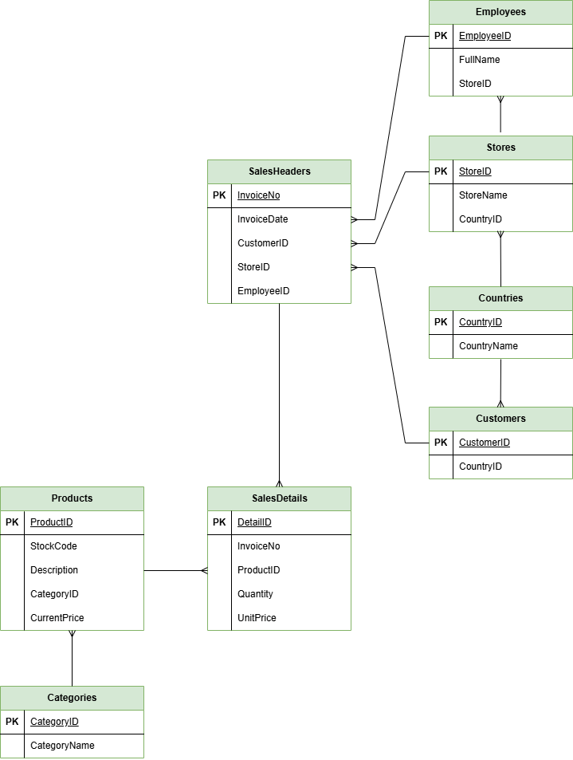
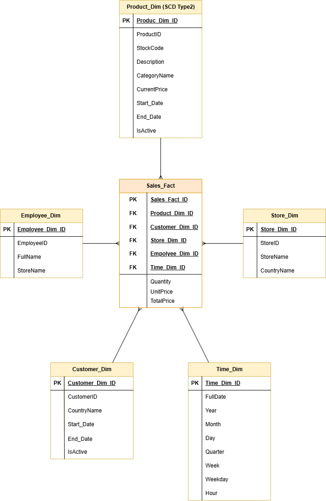

# Retail Data Warehouse & End-to-End BI Solution 

Select Language: [English](#english) | [Deutsch](#deutsch)

---

## English: Project Documentation

### Project Scope
This project implements a complete data pipeline, migrating transactional records from an operational system into a Star Schema Data Warehouse. The solution focuses on data consistency, historical tracking via SCD Type 2, and advanced analytical reporting using SQL Server and Python.

#### Data Models
**OLTP ER Diagram**

**DWH Star Schema**

### Technical Stack
* **Database:** SQL Server (OLTP & DWH)
* **ETL Engine:** Python (Pandas, PyODBC)
* **Key Features:** SCD Type 1 & 2 implementation, Persisted Computed Columns, and Keyword-based Categorization.

### Repository Structure
* `sql_scripts/`: SQL definitions for schemas and business intelligence queries.
* `python_etl/`: ETL logic for data migration and DWH transformation.
* `documentation/`: ER diagrams, Star Schema models, and the Product Mapping logic.
* `documentation/images/`: Visual architecture and schema diagrams.

### Step-by-Step Execution Guide

#### 1. SQL Schema Initialization
* Execute `sql_scripts/01_create_oltp_schema.sql` to create the operational database and its sample countries, stores, and employees.
* Execute `sql_scripts/03_create_dwh_schema.sql` to deploy the Star Schema. The scripts drop and recreate their target databases if they already exist.
* `sql_scripts/02_base_information.sql` repeats sample data already inserted by the OLTP schema script; do not run it after `01_create_oltp_schema.sql`.

#### 2. Configuration
* Install the required libraries: `pip install pandas pyodbc openpyxl`.
* The scripts connect to `localhost` by default. Set `RETAIL_SQL_SERVER` to the SQL Server instance name if needed (for example, `localhost\MSSQLSERVER01`).
* Download the [UCI Online Retail dataset](https://archive.ics.uci.edu/static/public/352/online+retail.zip), extract `Online Retail.xlsx`, and convert it to `python_etl/data.csv`:
  `python -c "import pandas as pd; pd.read_excel('Online Retail.xlsx').to_csv(r'python_etl\data.csv', index=False, encoding='ISO-8859-1')"`

#### 3. Data Processing (ETL)
* Run `python python_etl/01_csv_to_oltp.py`: Cleans the source data and populates the OLTP system (the current script loads the first 5,000 records).
* Run `python python_etl/02_oltp_to_dwh.py`: Transforms data, applies SCD logic, and populates the Fact table.

#### 4. Analytics & Reporting
* Use `sql_scripts/04_analytical_queries.sql` in SSMS to generate reports on RFM Segmentation, Peak Sales Hours, and Regional Performance.

---

## Deutsch: Projektdokumentation

### Projektumfang
Implementierung einer vollständigen Daten-Pipeline zur Überführung transaktionaler Daten in ein Star Schema Data Warehouse. Der Fokus liegt auf Datenkonsistenz, Historisierung mittels SCD Typ 2 und Business-Reporting unter Einsatz von SQL Server und Python.

#### Datenmodelle
**OLTP ER-Diagramm**

**DWH Sternschema**

### Technologie-Stack
* **Datenbank:** SQL Server (OLTP & DWH)
* **ETL-Engine:** Python (Pandas, PyODBC)
* **Highlights:** SCD Typ 2 Implementierung, Persisted Computed Columns und Keyword-basiertes Mapping.

### Verzeichnisstruktur
* `sql_scripts/`: SQL-Skripte für Datenbank-Schemata und BI-Abfragen.
* `python_etl/`: ETL-Skripte für den Datentransfer und die DWH-Transformation.
* `documentation/`: ER-Diagramme, Star-Schema-Modelle und die Excel-Mapping-Tabelle.
* `documentation/images/`: Architektur-Visualisierungen und Schemadiagramme.

### Schritt-für-Schritt-Anleitung zur Ausführung

#### Schritt 1: Datenbank-Initialisierung
* Führen Sie `sql_scripts/01_create_oltp_schema.sql` aus, um die operative Datenbank und die Stammdaten zu erstellen.
* Führen Sie `sql_scripts/03_create_dwh_schema.sql` aus, um die Data Warehouse-Struktur (Sternschema) bereitzustellen.
* `sql_scripts/02_base_information.sql` fügt Stammdaten ein, die bereits durch das OLTP-Schema-Skript eingefügt werden; führen Sie es danach nicht erneut aus.

#### Schritt 2: Konfiguration
* Installieren Sie die benötigten Bibliotheken: `pip install pandas pyodbc openpyxl`.
* Standardmäßig verbinden sich die Skripte mit `localhost`. Setzen Sie `RETAIL_SQL_SERVER` auf den Namen Ihrer SQL-Server-Instanz, falls erforderlich.
* Laden Sie den [UCI Online Retail-Datensatz](https://archive.ics.uci.edu/static/public/352/online+retail.zip) herunter, entpacken Sie `Online Retail.xlsx` und konvertieren Sie die Datei in `python_etl/data.csv`:
  `python -c "import pandas as pd; pd.read_excel('Online Retail.xlsx').to_csv(r'python_etl\data.csv', index=False, encoding='ISO-8859-1')"`

#### Schritt 3: ETL-Durchführung
* Starten Sie `python python_etl/01_csv_to_oltp.py`: Bereinigt die Quelldaten und befüllt das OLTP-System (aktuell werden die ersten 5.000 Datensätze geladen).
* Starten Sie `python python_etl/02_oltp_to_dwh.py`: Transformiert die Daten, wendet die SCD-Logik an und lädt die Faktentabelle.

#### Schritt 4: Analyse & Reporting
* Nutzen Sie `sql_scripts/04_analytical_queries.sql` im SSMS für Berichte wie RFM-Segmentierung, Peak-Sales-Analysen und regionale Performance-Rankings.

---

### Prerequisites / Voraussetzungen
* Microsoft SQL Server & SSMS
* Python 3.x
* Online Retail Dataset
